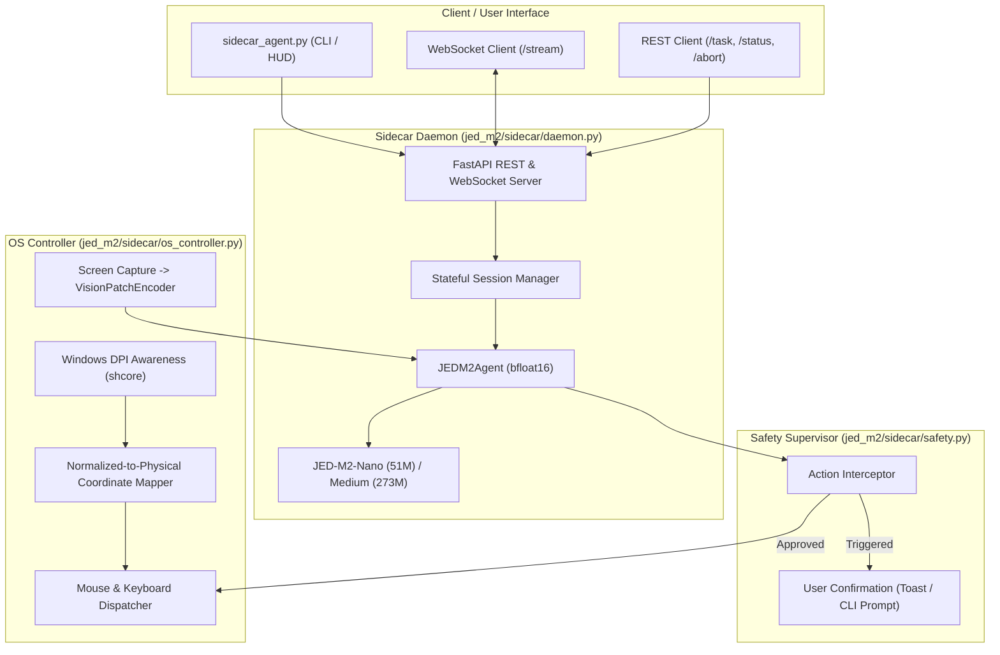

# Design

## Context

JED-M2 is a 100% native PyTorch Large Action Model utilizing a hybrid architecture of Mamba-2 Selective State Space Model (SSM) recurrence, Multi-Head Latent Attention (MLA), Top-2 Sparse Mixture-of-Experts (MoE), and a JEPA latent world model. While previous phases established headless browser execution (Playwright), synthetic benchmarks, and RL fine-tuning, real-world deployment requires a persistent, local Windows desktop runtime capable of interacting with arbitrary native applications, web browsers, and file managers.

The host environment is Windows 11 equipped with an NVIDIA GeForce RTX 5060 Laptop GPU (8.0 GB VRAM, with an operational ceiling of 6.0 GB). The sidecar must maintain an ultra-lightweight idle footprint (< 100 MB host RAM, 0% idle GPU) while delivering low-latency, DPI-accurate automation with robust human-in-the-loop safety.

See `proposal.md` for user motivation and `specs/` for behavioral requirements.

## Goals / Non-Goals

**Goals:**
- Provide a pure Python OS automation controller (`jed_m2/sidecar/os_controller.py`) with per-monitor DPI awareness (`ctypes.windll.shcore.SetProcessDpiAwareness(2)`), continuous normalized coordinate mapping $[0, 1] \to (X_{screen}, Y_{screen})$, smooth cursor movements, jittered keystroke typing, and screenshot capture into `VisionPatchEncoder` tensors.
- Implement an asynchronous FastAPI / asyncio sidecar daemon (`jed_m2/sidecar/daemon.py`) exposing `/task`, `/status`, `/abort`, and `/stream` (WebSocket) endpoints with sub-100 MB idle RAM footprint.
- Enable multi-turn stateful session persistence maintaining layer-wise Mamba SSM states, causal conv buffers, and MLA KV-cache across interaction steps without sequence length explosion.
- Build a human-in-the-loop safety supervisor (`jed_m2/sidecar/safety.py`) intercepting destructive commands, credential inputs, and financial transactions.
- Develop a unified CLI runner (`sidecar_agent.py`) supporting `daemon`, `exec`, and `monitor` commands with an interactive ASCII terminal HUD.
- Provide a comprehensive 5-test verification suite (`verify_phase13.py`).

**Non-Goals:**
- Multi-platform support for macOS or Linux (Windows 11-first implementation).
- Cloud-hosted orchestration or remote multi-tenant execution (designed for local workstation sidecar).
- Retraining or backpropagation fine-tuning during runtime execution.

## Decisions

### 1. Windows API Integration via ctypes with PyAutoGUI Integration & Fallback
- **Choice**: Implement screen metrics, DPI awareness, and input dispatch using `ctypes` (`user32.dll`, `shcore.dll`) with native integration with `pyautogui` when available, falling back to pure ctypes `SendInput` / `mouse_event` / `keybd_event` if `pyautogui` is absent.
- **Rationale**: Setting `ctypes.windll.shcore.SetProcessDpiAwareness(2)` (PROCESS_PER_MONITOR_DPI_AWARE) forces the process to receive true physical screen pixel coordinates rather than virtualized DPI-scaled coordinates. Providing pure ctypes fallback ensures the system operates cleanly out-of-the-box without hard external package failures.
- **Alternatives considered**: 
  - *PyAutoGUI alone*: Lacks automatic DPI awareness initialization on Windows, causing systematic 25-50% coordinate offsets on 125%/150% scaling laptops.
  - *PyWin32*: Requires heavy external compiled binaries and complex installation.

### 2. FastAPI + Asyncio Event-Driven Daemon with Background Inference Worker
- **Choice**: Build the daemon using FastAPI and `uvicorn`, running agent decision rollouts in background tasks with an asynchronous event broadcast queue feeding WebSocket clients.
- **Rationale**: Keeps the HTTP/WebSocket event loop non-blocking and responsive to `/status` and `/abort` requests while PyTorch forward passes run. When idle, the event loop consumes near-zero CPU and 0% GPU.
- **Alternatives considered**:
  - *Synchronous Flask/WSGI*: Blocks on multi-step rollouts and cannot natively handle low-latency WebSocket streaming.
  - *gRPC*: Introduces unnecessary protocol buffer compilation overhead for a local workstation daemon.

### 3. Stateful Multi-Turn Session Persistence via Agent Recurrent Buffers
- **Choice**: Encapsulate active rollout state within a `SidecarSession` maintaining `recurrent_states` (tuples of Mamba SSM hidden state $[1, D_{inner}, N]$, conv buffer $[1, D_{inner}, D_{conv}]$, and MLA KV cache per layer), step counter, and history.
- **Rationale**: Directly leverages `JEDM2Agent`'s $O(1)$ constant-memory recurrence. State remains resident in GPU memory between turns, eliminating full-history token recomputation and preventing VRAM growth.
- **Alternatives considered**:
  - *Re-feeding complete token trajectory on each turn*: Leads to $O(T^2)$ latency scaling and eventual context window exhaustion.
  - *Stateless single-turn reset*: Destroys memory of previous actions and UI transitions.

### 4. Deterministic Rule-Based Action Interceptor
- **Choice**: Implement `SafetySupervisor` in `jed_m2/sidecar/safety.py` inspecting candidate actions before dispatch. Uses pattern matching on destructive commands (`rm`, `del`, `format`, `rmdir`, `fdisk`), password/auth input fields, and payment/financial submission keywords ("place order", "pay now", "credit card", "cvv").
- **Rationale**: Provides zero-latency, deterministic interception before mouse clicks or keystrokes reach the OS. Automatically pauses execution and alerts the user via Windows toast notification or CLI input.
- **Alternatives considered**:
  - *Secondary LLM safety prompt*: Adds 200-500 ms latency per step and suffers from hallucination/jailbreaks.
  - *Post-action verification*: Cannot revert irreversible destructive OS actions.

### 5. Unified CLI and Real-Time ASCII HUD
- **Choice**: Provide `sidecar_agent.py` with subcommands `daemon`, `exec`, and `monitor`. The monitor interface renders a terminal HUD displaying live System 2 thinking, action summary, gate probability, and an ASCII 2D screen coordinate crosshair overlay.
- **Rationale**: Offers immediate, visual pair-programming feedback in standard PowerShell or Windows Terminal without requiring a separate web UI or Electron client.

## Architecture Diagram

## Risks / Trade-offs

- **[Risk] Display scaling mismatch or multi-monitor boundary anomalies** → *Mitigation*: Call `SetProcessDpiAwareness(2)` on startup; query exact monitor rects dynamically using `user32.GetSystemMetrics` and clamp coordinates within physical monitor boundaries.
- **[Risk] Mouse or keyboard capture blocking user emergency control** → *Mitigation*: Implement emergency abort hotkey / corner fail-safe and expose non-blocking `POST /abort` endpoint that instantly sets an atomic cancellation flag.
- **[Risk] PyTorch inference latency blocking FastAPI event loop** → *Mitigation*: Execute model inference turns in asynchronous executor threads (`asyncio.to_thread`), keeping REST and WebSocket event handling responsive.
- **[Risk] VRAM overflow when loading models on 8GB RTX 5060 Laptop GPU** → *Mitigation*: Run all tensor computations in `torch.bfloat16` with `torch.inference_mode()`. JED-M2-Medium footprint is ~2.8 GB, well within the 6.0 GB ceiling.

## Migration Plan

All additions are additive under `jed_m2/sidecar/`, `sidecar_agent.py`, and `verify_phase13.py`. Existing modules (`jed_m2/agent.py`, `jed_m2/model.py`, `jed_m2/vision.py`) and existing spec suites remain untouched and fully backward-compatible.
